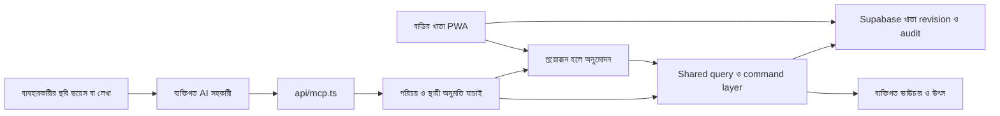

# বাড়ির খাতার MCP তৈরির পরিকল্পনা

এই MCP server দিয়ে প্রত্যেক ব্যবহারকারী নিজের ব্যক্তিগত AI সহকারীকে বাড়ির খাতায় কাজ করার অনুমতি দিতে পারবেন। ছবি, ভয়েস বা লেখা থেকে সহকারী তথ্য বুঝে সঠিক খাতে হিসাব রাখবে; ব্যক্তি, দোকান ও কাজ শনাক্ত করবে; সারাংশ, বাকি, অগ্রিম এবং সম্পূর্ণ ইতিহাস দেখবে; অনুমতি থাকলে সংশোধন, বাতিল ও ফিরিয়ে আনাও করতে পারবে। একবার দেওয়া স্থায়ী অনুমতির মধ্যে দৈনন্দিন কাজ করতে প্রতিবার অ্যাপ খোলার প্রয়োজন হবে না।

পরিকল্পনার তারিখ: ২ নভেম্বর ২০২৬। সংযোগের লক্ষ্য remote MCP এবং একাধিক ব্যবহারকারীর নিজস্ব এক বা একাধিক সহকারী। শুধু পড়ার milestone দিয়ে পূর্ণ feature সম্পূর্ণ ধরা হবে না; এই পরিকল্পনার লেখার কাজ, media প্রবাহ, ইতিহাস, অনুমতি এবং গ্রহণযোগ্যতার পরীক্ষা শেষ করতে হবে। নির্দিষ্ট client-এর media ও protocol সামঞ্জস্য পরীক্ষা করে সমর্থনের তালিকা প্রকাশ হবে।

বাস্তবায়নে official SDK, ২৮টি command, ১২টি মূল query, স্থায়ী grant, নিজস্ব opaque-token OAuth gateway, ভাউচার, audit এবং Settings-এর সংযোগ-পর্দা যোগ হয়েছে। ব্যবহার ও সার্ভার প্রস্তুতির বর্তমান নির্দেশনা [MCP.md](MCP.md)-এ আছে। স্থানীয় database ও HTTP প্রবাহ যাচাই করা হয়েছে; production migration/deployment এবং বাইরের নির্দিষ্ট সহকারীতে certification আলাদা যাচাই। নিচের কর্মক্ষমতার সংখ্যাগুলো প্রস্তাবিত লক্ষ্য, অর্জিত ফলের দাবি নয়।

## দৈনন্দিন ব্যবহারের ফল

| ব্যবহারকারীর নির্দেশ                                                          | সঠিক ফল                                                                                                                   |
| ----------------------------------------------------------------------------- | ------------------------------------------------------------------------------------------------------------------------- |
| ৬০,০০০ টাকার সিমেন্টের বিলের ছবি দিয়ে বলেন, “২০,০০০ দিয়েছি, ছাদের খাতায় রাখো” | ৬০,০০০ টাকার মাল কেনা ও ২০,০০০ টাকা দেওয়া আলাদা ঘটনা; বাকি ৪০,০০০। দোকান ও কাজের ID শনাক্ত হয়, পাওয়া গেলে ভাউচার জোড়া হয়। |
| ভয়েসে বলেন, “দোকানের আগের বাকি ছয় হাজার দিলাম”                                | ৬,০০০ টাকা পরিশোধ হয়; নতুন খরচ শূন্য।                                                                                     |
| বলেন, “মিস্ত্রি নিজের টাকায় ১,৫০০ টাকার মাল কিনেছেন, তাঁকে মোট ১,৭০০ দিলাম”   | মালামালের খরচ ১,৫০০; দেওয়া টাকা ১,৭০০; অগ্রিম ২০০; মজুরি শূন্য।                                                           |
| বলেন, “গত মাসে রডে কত খরচ, ওই দোকানে এখন কত বাকি?”                            | গত মাসের খরচ এবং বর্তমান সম্পূর্ণ খাতার বাকি আলাদা ভিত্তিসহ দেখায়।                                                        |
| বলেন, “আগের বিলটায় ৬,৫০০ নয়, ৫,৬০০ হবে”                                       | নির্দিষ্ট পুরোনো এন্ট্রি শনাক্ত করে কারণসহ সংশোধন হয়; নতুন বিল তৈরি হয় না, আগের সংস্করণ থাকে।                             |
| বলেন, “এ দোকানের শুরু থেকে সব লেনদেন দেখাও”                                   | সব অনুমোদিত page নিয়ে সম্পূর্ণ বিবরণী, সংশোধন ও বাতিল হওয়া ঘটনা দেখা যায়।                                                 |

ছবি বা ভয়েস বোঝার ক্ষমতা থাকবে ব্যবহারকারীর বেছে নেওয়া সহকারীর মধ্যে। MCP structured command গ্রহণ করবে এবং যাচাই করে কাজ করবে। যে client মূল media bytes দিতে পারে না, সে বিশ্লেষিত তথ্য দিয়ে হিসাব রাখতে পারবে; মূল ফাইল জোড়া হয়েছে বলে দাবি করতে পারবে না।

## বর্তমান ব্যবস্থা এবং তার প্রভাব

| বর্তমান ব্যবস্থা                                             | MCP তৈরির সিদ্ধান্ত                                                                                                                      |
| ------------------------------------------------------------ | ---------------------------------------------------------------------------------------------------------------------------------------- |
| React/Vite PWA, `api/*.ts` ও `server/*.ts`                   | একই প্রকল্পে `api/mcp.ts` এবং `server/mcp/` যোগ হবে।                                                                                     |
| অ্যাকাউন্টভিত্তিক Dexie/IndexedDB                            | MCP অনলাইনে থাকা খাতা পড়বে; অন্য ফোনের অসমাপ্ত বা অনলাইনে না যাওয়া লেখা দেখতে পারবে না।                                                  |
| Supabase-এ একজন মালিকের পুরো খাতা একটি JSON document         | শুরুতে snapshot adapter থাকবে; পরিমাপের পরে indexed storage প্রয়োজন কি না স্থির হবে।                                                     |
| `load_ledger_snapshot()` এবং `save_ledger_snapshot(...)`     | snapshot, revision ও একই অনুরোধ আবার পাঠানোর নিয়ম পুনর্ব্যবহার হবে; MCP-এর জন্য অনুমতি যাচাইয়ের নতুন সীমানা লাগবে।                       |
| Zod এবং domain-এর হিসাবের নিয়ম                               | MCP-তে নতুন করে বাকি বা খরচের সূত্র লেখা হবে না।                                                                                         |
| `buildQuickEntry` এখন `src/features/entries/quickEntry.ts`-এ | প্রয়োজনীয় অংশ UI থেকে আলাদা করে অ্যাপ ও MCP-এর ব্যবহারযোগ্য command layer হবে; UI-এর default দিয়ে media থেকে payment অনুমান করা যাবে না। |
| revision আলাদা হলে outbox, conflict এবং recovery copy থাকে   | MCP থেকে হিসাব বদলালেও ফোনের না পাঠানো হিসাব চেপে লেখা যাবে না।                                                                          |

পুনর্ব্যবহারের প্রধান ফাইল: `src/domain/model.ts`, `src/domain/ledger.ts`, `src/domain/money.ts`, `src/domain/cashSummary.ts`, `src/domain/contracts.ts`, `src/domain/effectiveAccounts.ts` এবং `src/domain/entityDeletion.ts`। Browser-এর `src/data/sync.ts` বা IndexedDB repository সরাসরি server-এ import হবে না।

## সার্ভারের কাঠামো



প্রস্তাবিত endpoint `/api/mcp`, transport Streamable HTTP। ছোট request/response এবং স্থায়ী তথ্য Supabase-এ রাখলে বর্তমান Vercel Functions কাঠামোর সঙ্গে মেলে। দীর্ঘ সময় খোলা connection বা process-এর স্মৃতিতে অনুমতি ও অসমাপ্ত অনুরোধ রাখার প্রয়োজন হবে না। স্থানীয় পরীক্ষার জন্য Vite middleware থাকবে। [Vercel Functions](https://vercel.com/docs/functions)।

বর্তমান official TypeScript SDK-এর stable v2 থেকে শুরু করে client পরীক্ষায় পাস করা সংস্করণ pin করতে হবে। ২০২৬ সালের protocol-এর সঙ্গে আগের client-এর আচরণ আলাদা হতে পারে; SDK-এর compatibility path পরীক্ষা করেই সমর্থিত client ও protocol version লিখতে হবে। হাতে JSON-RPC বা পুরোনো SSE protocol বানানো হবে না। [TypeScript SDK](https://github.com/modelcontextprotocol/typescript-sdk), [Streamable HTTP specification](https://modelcontextprotocol.io/specification/2026-07-28/basic/transports/streamable-http)।

প্রথম সংযোগ থেকেই পরিচয় যাচাই লাগবে। স্থানীয় `stdio` adapter প্রয়োজন হলে পরে একই tool layer ব্যবহার করতে পারবে। MCP server নিজে model চালাবে না; এই কাজের জন্য server-এ OpenAI API key রাখার প্রয়োজন নেই।

## লগইন ও অনুমতি

বর্তমান Supabase Auth দিয়ে মালিক অ্যাপে লগইন করেন। MCP-এর নিজস্ব OAuth gateway `/api/mcp-auth` থেকে সহকারীর জন্য আলাদা opaque access/refresh token দেয়; সাধারণ Supabase session সহকারীর কাছে যায় না। `/mcp/consent` পাতায় সহকারীর পরিচয়, ফিরে যাওয়ার ঠিকানা ও অধিকার দেখে মালিক সম্মতি দেন। PKCE S256, সঠিক registered redirect, একবার ব্যবহারযোগ্য code, resource binding, মেয়াদ, refresh rotation/reuse এবং discovery metadata যাচাই হয়। Supabase-এর native OAuth Server আলাদা করে চালু করার প্রয়োজন নেই। [MCP authorization](https://modelcontextprotocol.io/specification/2026-07-28/basic/authorization)।

প্রস্তাবিত `mcp_connections`-এ মালিক, যাচাই করা OAuth `client_id`, authorization grant/session-এর সঙ্গে বাঁধা connection ID, অনুমোদিত কাজ, policy version ও বাতিলের অবস্থা থাকবে। একই client বহু ব্যবহারকারীর হয়ে কাজ করলেও প্রত্যেকের পরিচয়, অনুমতি, ফাইল ও অনুরোধের ফল আলাদা থাকবে। Client body থেকে পাঠানো connection ID নিজেরা পরিচয়ের প্রমাণ নয়। Token refresh হলেও আগের connection-এর অধিকারই থাকবে; নতুন অধিকার নীরবে যোগ হবে না।

| অধিকার                            | অনুমোদিত কাজ                                                                   |
| --------------------------------- | ------------------------------------------------------------------------------ |
| `ledger:read`                     | খোঁজা, নির্দিষ্ট হিসাব, সারাংশ, বিবরণী ও পরিবর্তনের ইতিহাস।                    |
| `entries:create`                  | নতুন বিল, পরিশোধ, অগ্রিম, reimbursement, মাল ফেরত ও টাকা ফেরত।                 |
| `entries:update`                  | সম্পর্ক ও ইতিহাসের নিয়ম মেনে সংশোধন।                                           |
| `entries:void_restore`            | কারণসহ বাতিল এবং ফিরিয়ে আনা।                                                   |
| `entities:write`                  | ব্যক্তি ও কাজ তৈরি, বদলানো, সরিয়ে রাখা ও ফিরিয়ে আনা।                           |
| `contracts:write`                 | চুক্তি তৈরি, শর্ত ও অবস্থা বদলানো এবং সংরক্ষিত ইতিহাস।                         |
| `catalog:write`                   | মাল, মালের ধরন, ব্র্যান্ড, ব্যবহার, একক ও টাকা দেওয়ার উদ্দেশ্য তৈরি বা সংশোধন। |
| `receipts:read`, `receipts:write` | ব্যক্তিগত ভাউচার দেখা এবং যাচাই করে জোড়া বা আলাদা করা।                         |

এগুলো application permission। প্রতিটি অনুরোধে এবং database operation-এ চলতি grant ও প্রকৃত পরিবর্তন থেকে প্রয়োজনীয় অধিকার যাচাই হয়। একটি connection মালিকের খাতার ওপর কাজ করে; এই সম্মতি স্পষ্ট থাকে। আলাদা কাজ বা ব্যক্তির মধ্যে সীমিত অধিকার দেখানোর আগে query, related entity ও receipt-সহ সম্পূর্ণ সীমা কার্যকর করতে হবে। অসম্পূর্ণ সীমিত অধিকার দেখানো যাবে না।

সংযোগের সময় মালিক শুধু দেখা, দৈনন্দিন কাজ অথবা সব কাজ থেকে শুরু করে আলাদা অধিকার বেছে নিতে পারেন। সরাসরি কাজের অনুমতিতে প্রতিবার নতুন অনুমোদন লাগে না। Settings-এ আগে দেখানোর ব্যবস্থা ও একবারের অঙ্কের সীমা আছে; management API-তে দৈনিক মোট অঙ্ক ও কাজের সংখ্যার সীমাও আছে। Server command-এর প্রকৃত আর্থিক প্রভাব দিয়ে সীমা যাচাই করে; client-এর বর্ণনা বা `approved: true` বিশ্বাস করে না। একবারের অঙ্কের সীমা ছাড়ালে মালিক নির্দিষ্ট প্রস্তাব অনুমোদন দিতে পারেন; দৈনিক সীমা বহাল থাকে। Client-এর নিজস্ব confirmation ব্যবস্থা থাকলে সেটিও client-এর নিয়ন্ত্রণে থাকে।

প্রথম পূর্ণ সংস্করণের সব কাজের profile-এ `ledger:read` ভিত্তি হিসেবে থাকবে এবং সম্মতিতে তা বোঝানো হবে। একটি command-এর মধ্যে নতুন ব্যক্তি, মাল বা payment তৈরি হলে প্রতিটি অন্তর্ভুক্ত কাজের অধিকার লাগবে; বাইরের command-এর নাম দিয়ে অতিরিক্ত কাজ পাশ কাটানো যাবে না। অঙ্কের সীমায় bill ও cash প্রভাব এবং batch-এর মোট প্রভাব আলাদা যাচাই হবে। Grant সীমিত বা বাতিল হলে আগে তৈরি proposal-ও নতুন অধিকার পাবে না।

**সহকারীর টোকেন ও মালিকের লগইন আলাদা সীমানায় থাকে।** শুধু MCP tool-এ লেখার বোতাম লুকিয়ে অধিকার নিয়ন্ত্রণ করা হয় না।

- সহকারীর opaque token দিয়ে সাধারণ Supabase Auth, snapshot RPC, raw table, share বা account-delete API ব্যবহার করা যায় না। অ্যাপের নিজের লগইনের পথ আগের মতো চলে।
- Server-side adapter MCP-এর service-only RPC ব্যবহার করে। RPC token hash থেকে owner/connection বের করে grant, revision, সীমা ও প্রকৃত পরিবর্তন যাচাই করে। Model-এর `owner_id` দিয়ে মালিকানা বাছা যায় না।
- `service_role` শুধু server-এর যাচাই করা adapter, নির্দিষ্ট MCP RPC এবং private storage-এর কাজে থাকে; browser, সহকারী বা tool result-এ যায় না। সাধারণ app client নতুন private MCP table বা helper চালাতে পারে না।
- সহকারী নিজেকে grant দিতে, বাতিল সংযোগ চালু করতে, প্রস্তাব পাল্টাতে বা অনুমোদন দিতে পারে না। Approval endpoint প্রথম পক্ষের যাচাই করা Supabase user session চায়।
- `SECURITY DEFINER` helper-এর মধ্যে owner ও অধিকার নিজে যাচাই হয়। Table-এর RLS একাই এই function-কে সীমিত করে ধরে নেওয়া হয় না।
- Token শুধু hash হিসেবে থাকে; revoke, code expiry ও refresh family-এর সিদ্ধান্ত database-এ স্থায়ীভাবে থাকে।

MCP route-এ উপস্থিত `Origin` ও অনুমোদিত host যাচাই, request-এর আকার ও কাজের সময়ের সীমা এবং মালিক ও client ধরে ব্যবহারসীমা থাকবে। একাধিক function instance-এ ব্যবহারসীমা কার্যকর হতে হবে। ব্যক্তিগত উত্তরে `Cache-Control: no-store` থাকবে; token বা সম্পূর্ণ খাতা log করা যাবে না।

OAuth access/refresh token নির্দিষ্ট MCP resource-এর সঙ্গে বাঁধা থাকে। সাধারণ unrestricted user session বা অন্য resource-এর token গ্রহণ করে সামনে পাঠানো হয় না। [MCP token security](https://modelcontextprotocol.io/docs/2026-07-28/tutorials/security/security_best_practices)।

## পড়া খোঁজা ও শনাক্ত করার tool

| Tool                   | কাজ                                                                                                 |
| ---------------------- | --------------------------------------------------------------------------------------------------- |
| `get_ledger_context`   | খাতার পরিচয়, প্রযোজ্য হিসাবের নিয়ম, cloud revision এবং তথ্যের সময় জানানো।                           |
| `search_entities`      | ব্যক্তি, দোকান, কাজ ও মালের নাম খুঁজে নির্দিষ্ট ID নেওয়া। একই নাম একাধিক হলে পছন্দ পরিষ্কার করা।    |
| `get_summary`          | সময়সীমার খরচ ও দেওয়া টাকা এবং বর্তমান খাতার বাকি ও অগ্রিম আলাদা দেখা; কাজ বা হিসাবের ধরন ধরে বাছাই। |
| `list_entries`         | ব্যক্তি, কাজ, তারিখ ও ঘটনার ধরন ধরে সীমিত তালিকা।                                                   |
| `get_entry`            | একটি ঘটনার বিস্তারিত, সম্পর্কিত পরিশোধ এবং সংশোধনের ইতিহাস।                                         |
| `get_person_statement` | একজন ব্যক্তি বা দোকানের বিল, দেওয়া টাকা, ফেরত এবং চলতি বাকি।                                        |
| `get_contract_summary` | ঠিক করা টাকা, দেওয়া টাকা, চুক্তির অবশিষ্ট এবং বর্তমানে দাবি করা বাকি আলাদা দেখা।                    |

পূর্ণ সংস্করণে `get_capabilities`, `get_entity`, `get_work_statement`, `list_history`, `get_change_history`, `get_operation_status` এবং `export_statement` যোগ হবে। Capabilities-এ schema version, অনুমোদিত tool ও command, timezone, file limit, batch limit এবং grant policy থাকবে। History-তে এন্ট্রি, সংশোধন, void/restore, ব্যক্তি, কাজ, চুক্তি ও সহকারীর কাজ আলাদা filter-এ পাওয়া যাবে।

বাংলা ও ইংরেজি অঙ্ক, বানানের সামান্য পার্থক্য এবং আগের alias দিয়ে খোঁজা যাবে। Normalization শুধু খোঁজার জন্য হবে; মূল নাম বদলাবে না। একই নামের একাধিক দোকান বা কাজ পেলে candidate ID, ধরন ও প্রাসঙ্গিক তথ্য ফেরত আসবে। স্থায়ী ID মিলে গেলেও বর্তমান খাতায় সক্রিয় ও প্রাসঙ্গিক কি না যাচাই হবে। Archived নাম খোঁজায় স্পষ্টভাবে চিহ্নিত হবে।

প্রতি tool-এর Zod input/output schema থাকবে। ফল হবে `structuredContent` এবং সংক্ষিপ্ত বাংলা ব্যাখ্যা। প্রতিটি পড়ার ফলে `source: "cloud"`, `revision`, `updated_at`, `currency: "BDT"` থাকবে। স্থানীয় না পাঠানো লেখা অজানা বলে সম্পূর্ণ সিঙ্ক হওয়ার দাবি করা যাবে না। ফলের মূল অঙ্ক পূর্ণসংখ্যার `amount_paisa`; প্রদর্শনের টাকা আলাদা।

সময় বেছে নিলে শুধু ওই সময়ের খরচ ও cash flow বাছাই হবে। বাকি ও অগ্রিম আসবে সম্পূর্ণ বর্তমান snapshot থেকে, সঙ্গে `balance_basis: "current_snapshot"` থাকবে। যেমন আগের মাসের বিল চলতি মাসে মেটালে ওই পরিশোধ চলতি মাসের দেওয়া টাকায় আসবে, নতুন খরচ হবে না এবং পুরোনো বিল বাদ দিয়ে বাকি হিসাব করা যাবে না। অজানা তারিখের ঘটনা আলাদা করে দেখাতে হবে। অতীতের কোনো তারিখে বাকি কত ছিল তা চাইলে একটি আলাদা `as_of` query-এর নিয়ম লাগবে; তা ছাড়া বর্তমান বাকি পুরোনো দিনের বাকি হিসেবে দেখানো যাবে না।

তালিকার প্রাথমিক সীমা ৩০, সর্বোচ্চ ১০০। Cursor-এর সঙ্গে filter ও revision বাঁধা থাকবে; মাঝখানে খাতা বদলালে নতুন করে পড়তে হবে। এক উত্তরে পুরো খাতা বা সব ভাউচার ফেরত দেওয়া হবে না। বিলের নোট ও আমদানি করা লেখা তথ্য হিসেবে গণ্য হবে; সেগুলো নতুন নির্দেশ বা অনুমতি হবে না।

প্রতিটি tool-এর বর্ণনায় কখন ব্যবহার করতে হবে, প্রয়োজনীয় field, টাকার একক এবং সফল বা ব্যর্থ ফলের উদাহরণ থাকবে। অনুমতি অনুযায়ী স্থির ক্রমে tool discovery হবে। `needs_clarification`, `validation_error`, `permission_denied`, `not_found`, `dependency_conflict`, `revision_conflict`, `approval_required`, `approval_expired`, `possible_duplicate` এবং `rate_limited` স্থির code হবে। Result-এ `retryable`, প্রয়োজনীয় field বা candidate এবং পরের বৈধ কাজ থাকবে। Client প্রয়োজনীয় অঙ্ক না বুঝলে server-কে তা বোঝার দাবি করা যাবে না। Tool annotation আচরণ বোঝাবে; প্রকৃত অনুমতি server ও database যাচাই করবে। [MCP tools](https://modelcontextprotocol.io/specification/2026-07-28/server/tools)।

## লেখা সংশোধন এবং খাতার ব্যবস্থাপনা

বাইরের tool হবে `preview_change`, `apply_change`, `get_operation_status` এবং সীমিত `apply_batch`। `command.type` অনুযায়ী Zod discriminated union দিয়ে field বাধ্যতামূলক হবে; unrestricted patch, SQL বা পুরো ledger JSON নেওয়া যাবে না। বড় schema-তে কোনো লক্ষ্য client নির্ভরযোগ্যভাবে কাজ না করলে একই application command-এর ওপর ছোট কাজভিত্তিক tool থাকবে; দুটি পথে অনুমতি ও ফল একই থাকবে।

| Command-এর দল   | পূর্ণ সংস্করণের কাজ                                                                                                                                                                |
| --------------- | ---------------------------------------------------------------------------------------------------------------------------------------------------------------------------------- |
| নতুন হিসাব      | `create_purchase`, `record_wage`, `create_cost`, `record_payment`, `record_advance`, `record_procurement`, `record_reimbursement`, `record_material_return`, `record_cash_refund`। |
| এন্ট্রির সংশোধন | `update_entry`, `void_entry`, `restore_entry`; কারণ ও target version বাধ্যতামূলক।                                                                                                  |
| ব্যক্তি ও কাজ   | তৈরি, নাম ও বৈধ তথ্য বদলানো, কাজের অবস্থা/তারিখ, archive ও restore।                                                                                                                |
| চুক্তি          | তৈরি, কারণসহ শর্ত ও মোট টাকা বদলানো, status, archive ও restore; আগের চুক্তি ও payment সম্পর্ক অক্ষত।                                                                               |
| মালের তালিকা    | group/item, brand, usage, unit, alias ও payment purpose তৈরি/সংশোধন; ব্যবহৃত purpose-এর account ইচ্ছেমতো বদলানো যাবে না।                                                           |
| ভাউচার          | যাচাই করা asset এন্ট্রিতে জোড়া বা আলাদা করা; metadata ও উৎসের ইতিহাস রাখা।                                                                                                         |

একটি purchase command-এর bill ও payment অথবা material return ও সংশ্লিষ্ট cash refund আলাদা ঘটনা হিসেবে এক transaction-এ থাকতে পারবে। Batch-এর প্রথম সংস্করণে সর্বোচ্চ ২০টি command এবং সব সফল অথবা কোনোটিই সংরক্ষিত নয়—এই ফল থাকবে। কিছু সফল কিছু ব্যর্থ হয়েছে এমন অস্পষ্ট উত্তর দেওয়া যাবে না।

1. Command-এ `idempotency_key`, বর্তমান revision, প্রাসঙ্গিক target ID/version, স্পষ্ট amount/date/event type এবং optional source/asset ID থাকবে। Mutation-এর আগে বর্তমান খাতা, command এবং পরে তৈরি পুরো খাতা যাচাই হবে।
2. পর্যাপ্ত স্থায়ী grant থাকলে `apply_change` সরাসরি সংরক্ষণ করবে। `preview_change` চাইলে আগে ও পরে খরচ, দেওয়া টাকা, বাকি ও অগ্রিম দেখাবে। Client-এর confidence বা preview ব্যবহার server-এর validation-এর বিকল্প নয়।
3. Policy অনুযায়ী অনুমোদন দরকার হলে immutable প্রস্তাব database-এ থাকবে: owner, connection/client, normalized command, তৈরি ID, base revision, candidate digest, মেয়াদ এবং status। শুধু সরাসরি লগইন করা মালিক সেই নির্দিষ্ট প্রস্তাব মেনে নিতে পারবেন।
4. একই transaction-এ চলতি grant, limit, target version, অনুমোদন প্রযোজ্য কি না, digest এবং revision যাচাই করে ledger, operation result, append-only audit ও প্রস্তাবের status লেখা হবে। Connection revoke ও commit নির্দিষ্ট row lock-এর ক্রমে চলবে; revoke আগে কার্যকর হলে commit হবে না।
5. Owner ও connection-এর অধীনে একই key ও একই normalized command আবার এলে আগের persisted ফল আসবে; অন্য payload হলে বাতিল হবে। Source event-এর মধ্যে একাধিক বৈধ intent থাকলে আলাদা স্থির command ID থাকবে। Timeout-এর পরে `get_operation_status` দিয়ে ফল জানা যাবে। নতুন key বানিয়ে অন্ধভাবে retry করলে দ্বিতীয় লেনদেন হতে পারে—client নির্দেশনায় এটি স্পষ্ট থাকবে।
6. App বা অন্য সহকারী খাতা বদলালে `revision_conflict` হবে। প্রথম পূর্ণ সংস্করণে server নীরবে নতুন revision-এ financial command বসাবে না। Client নতুন অবস্থা পড়ে প্রাসঙ্গিকতা যাচাই করে আবার চেষ্টা করবে; বদলে যাওয়া অনুমোদিত প্রস্তাবের নতুন অনুমোদন লাগবে।

প্রতিটি সফল লেখায় operation ID, entry/entity ID, bill/payment/refund-এর আলাদা ফল, আগের ও পরের অঙ্ক, resulting revision, actor এবং অ্যাপে খোলার link থাকবে। সহকারী এগুলো দিয়ে ব্যবহারকারীকে কী রাখা হয়েছে তা বলবে। Operation-এর অবস্থা হবে `needs_clarification`, `awaiting_approval`, `committed`, `rejected`, `expired`, `conflicted` বা `failed`; model-এর ভাষার উত্তরকে save হওয়ার প্রমাণ ধরা যাবে না।

`void_entry` ও `restore_entry` স্পষ্ট action হবে, toggle নয়। Linked payment থাকলে এন্ট্রির person/account/work বদলানোর বর্তমান বাধা থাকবে; dependency conflict-এ বৈধ সংশোধনের পথ জানাতে হবে। স্থায়ীভাবে আর্থিক ইতিহাস মুছে ফেলার command থাকবে না। Taxonomy-তে এখন archive field নেই; সেই সুবিধা দিতে হলে model, SQL ও backup compatibility আগে যোগ করতে হবে। বিদ্যমান তথ্যের ভিত্তি বদলানো catalog operation বন্ধ থাকবে।

## ছবি ভয়েস এবং প্রমাণের প্রবাহ

ব্যক্তিগত সহকারী ছবি পড়বে বা কথা থেকে নির্দেশ বুঝবে, খোঁজার tool দিয়ে ব্যক্তি/দোকান/কাজ শনাক্ত করবে, তারপর নির্দিষ্ট command পাঠাবে। MCP server-এর মূল পথে নিজস্ব OCR বা speech model লাগবে না। আলাদা model service যোগ করলে সেটির credential, ব্যয় ও পরীক্ষা আলাদা কাজ হবে।

বিল, টাকা দেওয়ার রসিদ, কোটেশন এবং মাল পৌঁছানোর কাগজ একই প্রমাণ নয়। শুধু invoice-এর total দেখলে payment তৈরি হবে না। `QuickDraftSchema`-এর বর্তমান `payment: "full"` default এই পথে ব্যবহার করা যাবে না। Command-এ `payment_state: unpaid | partial | paid` এবং প্রযোজ্য দেওয়া টাকা স্পষ্ট লাগবে। Payment না জানা থাকলে nonfinancial draft ও clarification থাকবে; নিশ্চিত না হয়ে bill বা payment সংরক্ষণ হবে না। স্পষ্ট unpaid bill-এ নতুন payment হবে না। বর্তমান অজানা পরিশোধের `historical` আমদানির নিয়ম অক্ষত থাকবে।

অঙ্ক, ঘটনার অর্থ বা প্রয়োজনীয় reference অস্পষ্ট হলে `needs_clarification` ও সম্ভাব্য পছন্দ ফেরত আসবে। কাজের খাতা optional হলে অকারণে প্রশ্ন না করে বর্তমান সাধারণ খরচের নিয়ম চলবে। অনুমাননির্ভর তথ্য nonfinancial intake draft হিসেবে রাখা যাবে; `Entry.reviewStatus: "needs_review"` ব্যবহার করা যাবে না, কারণ সেই এন্ট্রিও হিসাবে যোগ হয়। সংযুক্ত কাগজের লেখা কোনো নতুন অনুমতি বা tool চালানোর নির্দেশ নয়।

উৎসের জন্য versioned provenance থাকবে: `origin: text | image | voice`, connection, source event, asset digest, প্রয়োজনীয় extracted field/evidence, command ও server time। বর্তমান `Entry.source` পুরোনো file/sheet/cell import-এর জন্য; সেটি এই উদ্দেশ্যে পুনর্ব্যবহার হবে না। পুরো chat, raw voice বা অপ্রয়োজনীয় ব্যক্তিগত লেখা স্বয়ংক্রিয়ভাবে রাখতে হবে না। Provenance যাতে পুরোনো client বা backup নীরবে মুছে দিতে না পারে, preservation guard ও schema compatibility লাগবে।

নকল আটকানো দুই ধরনের হবে। একই request/event retry নিশ্চিতভাবে একবারই লেখা হবে। একই asset hash, invoice number, দোকান, দিন ও অঙ্ক মিলে গেলে `possible_duplicate` এবং আগের entry দেখাবে। শুধু অঙ্ক বা একই ছবি দেখে প্রতিটি নতুন লেনদেন বাতিল হবে না; একাধিক page এবং একই receipt দিয়ে সংশোধন করার প্রবাহও থাকতে হবে। User-নিশ্চিত আলাদা লেনদেন একটি নির্দিষ্ট duplicate override reference নিয়ে রাখা যাবে; তা audit-এ থাকবে।

## ভাউচার এবং ফাইল

`create_receipt_upload → upload → finalize_receipt_upload → attach` প্রবাহ থাকবে। Upload session owner ও connection-এর সঙ্গে বাঁধা, সীমিত মেয়াদের হবে। Finalize-এ প্রকৃত bytes, MIME, magic bytes, আকার, checksum ও file-এর reference যাচাই হবে। ফাইল private staging-এ থাকবে; command সফল হওয়ার পরে active link হবে। ব্যর্থ command আর্থিক এন্ট্রি বা ভাঙা receipt reference তৈরি করবে না। Database ও object storage এক transaction নয় বলে upload state, orphan reconciliation ও মেয়াদোত্তীর্ণ staging cleanup স্পষ্টভাবে লাগবে।

Finalize-এর পরে যাচাই করা bytes নতুন server-generated immutable object/version-এ যাবে; তার SHA-256, size ও MIME স্থির থাকবে। Entry শুধু সেই version-এ জুড়বে। Valid upload URL বা app-এর পুরোনো upsert দিয়েও active file বদলানো যাবে না; storage policy ও PWA upload adapter-এ এই নিয়ম কার্যকর হবে। বদলানো বা আলাদা করা পুরোনো asset যদি current entry, revision বা pending operation-এ লাগে, তা cleanup মুছবে না। Backup-এর reference সংগ্রহে পুরোনো revision-এর ভাউচারও থাকবে।

প্রাথমিক file limit প্রতি ভাউচারে **১০ MiB**, format JPEG/PNG/WebP/PDF। এখন domain metadata ২৫ MiB পর্যন্ত মানলেও repository, draft, backup ও bucket ১০ MiB নেয়; নতুন upload-এ একই সীমা করতে হবে এবং পুরোনো metadata সামলানোর নিয়ম লিখতে হবে। Audio ও HEIC সরাসরি receipt format হিসেবে সমর্থিত দাবি করা যাবে না। Voice-এর structured নির্দেশ কাজ করবে; raw recording রাখা বাধ্যতামূলক নয়।

Attachment-capable client সীমিত upload URL ব্যবহার করতে পারবে। প্রয়োজনীয় client-এর জন্য chunk upload tool থাকবে; chunk size, মোট আকার ও checksum capabilities-এ প্রকাশ হবে। File দিতে না পারা client-এর হিসাব attachment ছাড়া চলবে এবং ফলেও তা জানাবে। Arbitrary URL server দিয়ে fetch করানো যাবে না। Upload URL অল্প সময় valid হলেও revoked connection finalize বা attach করতে পারবে না।

`list_receipts`, `get_receipt` এবং authenticated resource/download পথ থাকবে; প্রতিবার owner ও চলতি grant যাচাই হবে। স্থায়ী public URL হবে না। ছবি/PDF-র content স্বয়ংক্রিয় execution বা নতুন নির্দেশ হিসেবে নেওয়া যাবে না। Backup-এ ভাউচার, provenance ও entry-এর সম্পর্ক যাচাই করে থাকবে।

## টাকার নিয়ম

- সব হিসাব নিরাপদ পূর্ণসংখ্যার পয়সায় হবে। Input schema, বর্তমান খাতা, command-এর ফল এবং database-এর constraint সব স্তরেই যাচাই হবে। Decimal বা বাংলা অঙ্কের লেখা গ্রহণের প্রয়োজন হলে বর্তমান `money.ts` ব্যবহার হবে।
- মাল কেনার বিল ও একই সঙ্গে দেওয়া টাকা আলাদা ঘটনা, একটি atomic command-এ সংরক্ষিত হবে। পুরোনো বিল মেটালে আবার খরচ বাড়বে না। অতিরিক্ত টাকা দিলে অগ্রিম থাকবে।
- মিস্ত্রির নিজের টাকায় কেনা মাল ও তাঁকে সেই টাকা ফেরত দেওয়া মালামালের হিসাবে থাকবে। বর্তমান `canAssignContact` নতুন worker entry-কে labour-এ সীমিত করে; procurement/reimbursement command-এর নির্দিষ্ট নিয়ম তৈরি করে এই ঘাটতি পূরণ করতে হবে। পরিচিতির ধরন দেখে মজুরি বানানো যাবে না।
- মাল ফেরত দিলে বিলের সমন্বয় এবং টাকা ফেরত পেলে cash-এর পরিবর্তন হবে। দুটি এক করে ধরা যাবে না।
- চুক্তিতে ঠিক করা মোট টাকা নিজে থেকে খরচ নয়। চুক্তির বাকি ও ইতিমধ্যে করা বিলের বাকি আলাদা থাকবে। সংশোধনের কারণ ও আগের ইতিহাস অক্ষত থাকবে।
- পুরোনো `historical` বিল, চালকের `effectiveAccounts`, linked payment-এর বাধা এবং সরিয়ে রাখা ব্যক্তি বা কাজের বর্তমান নিয়ম বজায় থাকবে। অজানা তারিখ বা পরিশোধের প্রমাণ বানানো যাবে না।
- Date input হবে `YYYY-MM-DD`। “আজ” বা “গত মাস” হিসাব করতে `Asia/Dhaka` ও ব্যবহৃত তারিখসীমা স্পষ্ট থাকবে।

## অ্যাপের পরিবর্তন

সেটিংসে সহকারী সংযোগ, অধিকার ও সীমা বাছাই, চলতি সংযোগ দেখা, মেয়াদ ও শেষ কাজ জানা এবং অনুমতি বাতিল করার পাতা থাকবে। প্রয়োজনীয় অনুমোদন ও nonfinancial draft আলাদা করে দেখা যাবে। প্রতিটি এন্ট্রিতে কোন সহকারী কখন লিখেছে এবং কী বদলেছে তা পাওয়া যাবে। আবার সংযোগের সময় ব্যবহারকারী নিজের সঠিক অ্যাকাউন্ট বেছে নেবেন।

অ্যাপের ব্যবহারকারীর সব লেখা `useLanguageContext()` দিয়ে দেখাতে হবে। MCP-এর মানুষের পড়ার বার্তা একই translation catalog থেকে server-উপযোগী pure adapter দিয়ে আসবে; server-এ React hook ডাকা হবে না। Machine field ও error code স্থির থাকবে। Consent ও approval পাতা keyboard ও screen reader দিয়ে ব্যবহারযোগ্য হবে।

MCP-তে সংরক্ষণের পরে অ্যাপে sync, focus বা নির্দিষ্ট refresh-এ নতুন খাতা নামবে; কীভাবে নতুন তথ্য আসে তা দৃশ্যমান থাকবে। স্থানীয় পরিবর্তন থাকলে বিদ্যমান conflict দেখাবে এবং recovery copy রাখবে। লগইনের মেয়াদ শেষ হওয়া, অনুমতি বাতিল বা অ্যাপের update-এ স্থানীয় outbox ও খসড়া মোছা যাবে না। Background Realtime ছাড়াও এই প্রবাহ সম্পূর্ণ কাজ করতে হবে।

## একটি command-এর নমুনা

এটি কল্পিত তথ্য; প্রকৃত ID আগে search-এর ফল থেকে নিতে হবে। এই request-এ ৬০,০০০ টাকার বিল ও ২০,০০০ টাকা দেওয়ার অর্থ স্পষ্ট।

```json
{
  "idempotency_key": "invoice-example-001",
  "expected_revision": 42,
  "command": {
    "type": "create_purchase",
    "person_id": "example-shop",
    "work_id": "example-roof",
    "date": "2026-11-02",
    "lines": [
      { "label": "সিমেন্ট", "cost_type": "material", "amount_paisa": 6000000 }
    ],
    "payment_state": "partial",
    "payment": { "amount_paisa": 2000000, "method": "cash" },
    "receipt_ids": ["example-verified-receipt"],
    "provenance": { "origin": "image", "source_event_id": "example-message" }
  }
}
```

সফল ফল `status: committed`, bill ৬০,০০০, payment ২০,০০০, এই command-এর বাকি ৪০,০০০, তৈরি ID এবং নতুন revision জানাবে। দোকানের আগের হিসাব থাকলে মোট চলতি বাকি আলাদা field-এ থাকবে। একই request আবার পাঠালে একই operation ও ID ফেরত আসবে।

## প্রস্তাবিত ফাইল ও database পরিবর্তন

| জায়গা                                               | দায়িত্ব                                                                                                                  |
| --------------------------------------------------- | ------------------------------------------------------------------------------------------------------------------------ |
| `api/mcp.ts`                                        | Production Fetch entry point।                                                                                            |
| `server/mcp/`                                       | Protocol adapter, auth/policy, query, command, operation ও receipt handler এবং cloud adapter।                            |
| `server/mcpPlugin.ts`                               | স্থানীয় Vite route।                                                                                                      |
| `src/application/{ledgerCommands,ledgerQueries}.ts` | UI ও MCP-এর একই command/query, validation ও হিসাবের নিয়ম।                                                                |
| `src/domain/model.ts` ও history/backup validation   | Provenance, receipt limit ও প্রয়োজনীয় model evolution; পুরোনো client-এর preservation guard।                              |
| `src/features/integrations/`                        | Consent, connections এবং প্রস্তাবের পাতা।                                                                                |
| `src/context/LanguageProvider.tsx`                  | নতুন পাতার ভাষা।                                                                                                         |
| নতুন `supabase/migrations/*.sql`                    | Connections/grants, immutable operations/audit, proposals, intake/asset state, atomic command ও বর্তমান policy শক্ত করা। |
| `server/accountDelete.ts`                           | Delegated token দিয়ে account মুছে ফেলার পথ বন্ধ করা।                                                                     |
| `scripts/check-api-runtime.mjs`                     | নতুন API ও shared import Node ESM-এ চলে কি না যাচাই।                                                                     |
| `vite.config.ts`, `vercel.json`, `package.json`     | Local routing, OAuth metadata route-এর SPA rewrite থেকে ছাড়, server dependency ও পরীক্ষার command।                       |

নতুন browser dependency যত কম রাখা যায় তত ভালো। Server secret `VITE_*`-এ যাবে না। নমুনার পরীক্ষা synthetic fixture দিয়ে হবে; demo ও আসল খাতা একই token বা database ব্যবহার করবে না।

বর্তমান ledger ও backup-এর version ১। নতুন metadata প্রয়োজন হলে versioned schema ও migration হবে; পুরোনো backup যাচাই করে নতুন গঠনে আসবে। নতুন schema না বোঝা client-এর save/restore database-এ আটকাতে হবে এবং তার স্থানীয় outbox ও খসড়া অক্ষত থাকবে। Unknown field নীরবে বাদ দিয়ে পুরোনো client দিয়ে আবার পুরো snapshot লিখে ফেলা গ্রহণযোগ্য নয়।

## পরিচালনা এবং বড় ব্যবহারের প্রস্তুতি

প্রতিটি অনুরোধে correlation ID, operation ID, ফলের code, latency ও ব্যর্থতার স্তর জানা যাবে। Token, পুরো ledger, ব্যক্তিগত chat বা file bytes সাধারণ log-এ থাকবে না। Token refresh failure, বাড়তে থাকা conflict, database lock wait, upload failure ও ব্যবহারসীমা পর্যবেক্ষণ করতে হবে। Grant ও financial audit পরিবর্তন করে পুরোনো ইতিহাস মুছতে পারবে না। Operational log, intake draft ও পরিত্যক্ত ফাইলের retention আলাদা হবে।

বর্তমান snapshot পদ্ধতি owner অনুযায়ী lock করে; অনেক আলাদা ব্যবহারকারীর কাজ একই owner lock-এ আটকে থাকবে না। তবে প্রতিটি লেখায় পুরো document যাচাই ও সংরক্ষণ হয়। Database cap ১০ MiB; model-এ ১ লাখ entry অনুমোদন থাকা এত বড় খাতায় ভালো performance-এর প্রমাণ নয়। কেবল snapshot cache-এ সাম্প্রতিক অনুমতি বা revision বাদ দিয়ে উত্তর দেওয়া যাবে না।

Release-এর আগে synthetic ledger-এর আকার ও concurrency ধরে latency, memory, lock wait, conflict rate এবং search/pagination মাপতে হবে। প্রাথমিক পরীক্ষার লক্ষ্য: ১০ হাজার entry ও ১০ MiB-এর নিচে document, ৫০টি আলাদা account-এ concurrent read, এবং একই খাতায় একাধিক writer-এর race। প্রস্তাবিত server লক্ষ্য একই অঞ্চলের পরীক্ষায় সাধারণ read-এর p95 ২ সেকেন্ড ও write-এর p95 ৩ সেকেন্ডের মধ্যে; media transfer ও সহকারীর বিশ্লেষণের সময় আলাদা মাপতে হবে। এই সংখ্যাগুলো গ্রহণযোগ্যতার প্রস্তাব, অর্জিত ফল নয়।

এই মাপে snapshot scan বা contention অসহনীয় হলে indexed read model/normalized entry storage লাগবে। সে ক্ষেত্রে versioned snapshot compatibility রেখে browser sync ও backup চলতে হবে। শুধু endpoint তৈরি করে বড় ব্যবহারের উপযোগী বলা যাবে না।

## বাস্তবায়নের ধাপ

| ধাপ | কাজ                                                                                                                            | শেষ হওয়ার শর্ত                                                                                     |
| --- | ------------------------------------------------------------------------------------------------------------------------------ | -------------------------------------------------------------------------------------------------- |
| ০   | অন্তত দুটি স্বাধীন MCP client-এর compatibility, media capability, OAuth discovery/PKCE/audience এবং raw API-এর অনুমতি পরীক্ষা। | একটি desktop ও একটি remote/web প্রবাহের contract স্থির; delegated token খাতার বাইরে ক্ষমতা পায় না। |
| ১   | Shared domain command/query, explicit payment state, procurement/reimbursement, schema evolution ও backup preservation।        | UI ও command-এর একই হিসাব; media-এর অনিশ্চয়তা খাতায় আর্থিক ঘটনা তৈরি করে না।                       |
| ২   | Auth, standing grants/limits, revoke, DB/RPC/storage/account guard এবং connections UI।                                         | বৈধ স্থায়ী অনুমতিতে দৈনন্দিন লেখা চলে; read-only, expired ও revoked token দিয়ে নিষিদ্ধ কাজ চলে না। |
| ৩   | সম্পূর্ণ read/search/history, লেখা, সংশোধন, void/restore, ব্যক্তি-কাজ-চুক্তি-catalog এবং operation status।                     | প্রতিটি command-এর সফলতা, retry, dependency ও conflict test পাস।                                   |
| ৪   | Media intake/provenance, receipt upload/read, duplicate detection এবং প্রযোজ্য approval।                                       | ছবি/ভয়েসের বাস্তব client প্রবাহ, file failure ও উৎসের ইতিহাস পাস।                                  |
| ৫   | App sync/offline, IndexedDB reopen, backup restore, performance, client compatibility ও staged rollout।                        | নিচের পূর্ণ গ্রহণযোগ্যতার পরীক্ষা, runbook এবং rollback যাচাই পাস।                                 |

এগুলো অভ্যন্তরীণ milestone; চূড়ান্ত feature-এর পরিসর কমানো নয়। আগের সীমিত read-first পরিকল্পনার ৭–১২ কর্মদিবস এই পূর্ণ পরিসরের estimate নয়। OAuth/delegation এবং schema compatibility-এর ধাপ ০–১ শেষ হলে কাজ ভেঙে নতুন সময় নির্ধারণ করতে হবে।

## গ্রহণযোগ্যতার পরীক্ষা

1. দুই মালিক, প্রত্যেকের দুই সহকারী এবং ভিন্ন grant দিয়ে খাতা, search, media, operation ও history সম্পূর্ণ আলাদা থাকে। Forbidden ID থাকলেও অন্যের তথ্য ফাঁস হয় না।
2. Standing grant থাকলে app না খুলে image/voice থেকে বৈধ entry হয়। Read-only token দিয়ে MCP বা সরাসরি RPC/table/storage/share/account পথে লেখা যায় না। OAuth client নিজে grant বাড়াতে বা preview approve করতে পারে না।
3. ভুল issuer/audience, expired token, ভুল redirect ও নকল অনুমোদন বাতিল হয়। Token refresh নতুন অধিকার পায় না। Revoke-এর পরে চলতি token-এর নতুন কাজ বন্ধ; revoke/commit race-এর ফল নির্ধারিত থাকে।
4. ৬০,০০০ টাকার invoice ও স্পষ্ট ২০,০০০ paid-এ bill ৬০,০০০, payment ২০,০০০, due ৪০,০০০। শুধু bill-এর ছবি ও unknown payment-এ clarification/draft হয়; টাকা দেওয়া বা বাকি বানানো হয় না।
5. ভয়েসে “আগের বাকি ছয় হাজার দিলাম” বললে নতুন cost শূন্য। মিস্ত্রির ১,৫০০ টাকার মাল ও তাঁকে ১,৭০০ দেওয়া materials cost ১,৫০০, advance ২০০, labour শূন্য রাখে।
6. Mal return, cash refund, contract তৈরি/পরিবর্তন এবং entry correction/void/restore সঠিক অঙ্ক ও অপরিবর্তনীয় ইতিহাস রাখে। Linked payment-এর বাধা, ব্যবহৃত purpose-এর account ও archived entity-এর নিয়ম বজায় থাকে।
7. অস্পষ্ট অঙ্ক, ভুল reference, একই নামের দুই ব্যক্তি, allocation mismatch, duplicate ID, overflow এবং অসম্ভব তারিখে mutation হয় না। Model confidence বা ভাউচারের নির্দেশ validation/permission পাশ কাটাতে পারে না।
8. Lost response, server restart ও concurrent retry-তে একই key একবারই ঘটনা রাখে; ভিন্ন payload বাতিল হয়। সম্ভাব্য duplicate-এ আগের entry দেখায়; যাচাই করা আলাদা কেনাকাটা অনুমতি পায়। Batch-এর এক command ব্যর্থ হলে পুরো batch অক্ষত থাকে।
9. Entry update, connection limits, অন্য client-এর approved operation, expire হওয়া proposal এবং একই খাতায় app/দুই assistant-এর race-এ নিঃশব্দ overwrite হয় না। Audit, ledger ও operation result অর্ধেক লেখা থাকে না।
10. আংশিক, expired, ভুল MIME/bytes/hash বা অতিরিক্ত বড় upload খাতায় ভাঙা reference রাখে না। Finalize-এর পরে overwrite হয় না; attach/delete race-এ linked asset থাকে এবং পুরোনো revision-এর ভাউচার backup-এ থাকে। অন্যের asset দেখা বা জোড়া যায় না। Attachment transfer না থাকলে structured-only প্রবাহও সঠিকভাবে চলে।
11. MCP পরিবর্তন অ্যাপে sync, IndexedDB বন্ধ করে খোলা, backup ও restore-এর পরে অঙ্ক, receipt, provenance ও history অক্ষত রাখে। Offline pending লেখা, login expiry এবং update-এ খসড়া/উদ্ধার কপি থাকে। পুরোনো client নতুন metadata মুছে ফেলতে পারে না।
12. সম্পূর্ণ history ও export সব page নেয়; মাঝখানে revision বদলালে আংশিক ফল দেয় না। পুরোনো বিল চলতি মাসে মেটানোর রিপোর্টে flow ও বর্তমান balance মেলে। বাংলা/ইংরেজি search ও alias সঠিক ব্যক্তি শনাক্ত করে।
13. অন্তত দুটি লক্ষ্য client-এ connection, refresh/revoke, image/voice instruction, tool discovery, clarification, লেখা, correction, history এবং interruption recovery পাস। Raw attachment সমর্থন আলাদা করে পরীক্ষা ও নথিভুক্ত হবে।
14. Synthetic demo আসল খাতায় যায় না। Performance-এর নির্ধারিত মাপ, native Node ESM API runtime, স্থানীয় Supabase security integration এবং end-to-end browser suite পাস। `npm test` ও `npm run build` পাস।

## প্রকাশ এবং পরবর্তী পরিসর

`BARI_MCP_ENABLED=false` দিয়ে নতুন MCP অনুরোধ বন্ধ করা যায়। Connection grant দিয়ে শুধু পড়ার বা লেখার অধিকার আলাদা থাকে। প্রথমে synthetic/staging পরীক্ষা, তারপর সীমিত ব্যবহারকারী, শেষে পূর্ণ release। চলতি transaction অর্ধেক থাকবে না এবং স্থানীয় খসড়া থাকবে। Database migration versioned; ফেরত যাওয়ার জন্য হিসাব বা audit মুছে ফেলা যাবে না।

হিসাবের পূর্ণ backup/restore অ্যাপ থেকে থাকবে এবং MCP-সৃষ্ট তথ্যেও কাজ করবে। MCP দিয়ে পুরো খাতা restore/replace, স্থায়ী deletion, account/password পরিবর্তন, public share তৈরি, arbitrary file access ও SQL সাধারণ সহকারীর অধিকারের মধ্যে থাকবে না। পুরো হিসাব প্রতিস্থাপন বা প্রকাশের জন্য আলাদা administrative workflow লাগবে। নিজস্ব OCR/transcription service এবং খাতার অংশবিশেষে সীমিত permission ভবিষ্যতের আলাদা পরিসর; upstream assistant-এর image/voice থেকে দৈনন্দিন কাজ এই পূর্ণ release-এর মধ্যেই থাকবে।
